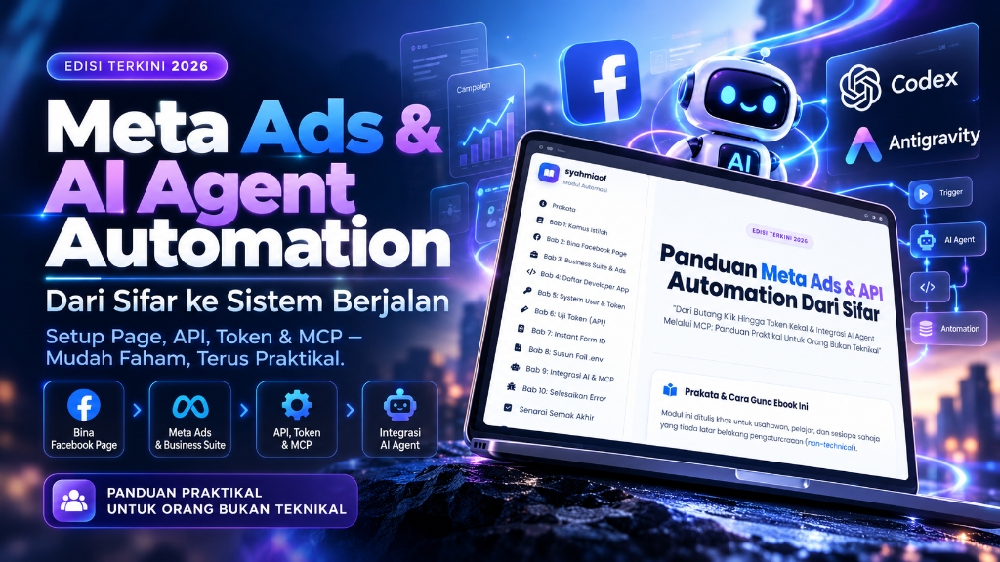

  <h1>MODUL META ADS & AI AGENT AUTOMATION</h1>
  
<strong>Dari Butang Klik Hingga Token Kekal & Integrasi AI Agent Melalui MCP: Panduan Praktikal Untuk Orang Bukan Teknikal.</strong>

  

    <a href="https://modul-meta-ads.syahmiaof.my">Live Module</a> · 
    <a href="https://docs.google.com/document/d/1gHJIwCtgYeH_Xh3beylTA--BeACOtN8WJsoleqB8S-w/edit">Google Docs Edition</a> · 
    <a href="https://syahmiaof.my">Portfolio</a> · 
    <a href="https://modulmetaads.vercel.app">Vercel Mirror</a>
  

> Panduan praktikal langkah-demi-langkah (*click-by-click*) menghubungkan ekosistem pemasaran Meta (Facebook Page, Business Suite, Graph API Explorer, System User Token) dengan orkestrasi ejen AI moden menggunakan Model Context Protocol (MCP). Ditulis khusus untuk usahawan, pelajar, dan pengguna bukan teknikal (*non-technical*).

## Workflow & System Architecture

~~~text
Facebook Page & Business Portfolio → Meta Developer App & Graph API Explorer → System User (Admin) → Never-Expiring Token (EAA...) → Environment Config (.env) → Antigravity AI Agent + MCP Tool → Autonomous Campaign & Lead Intelligence
~~~

Modul ini disusun rapi merangkumi 10 bab utama berserta senarai semak:

- **01 / Kamus Istilah Asas (`#bab1`)** — Penjelasan konsep teknikal (Page ID, Ad Account, Business Portfolio, Developer App, Access Token) menggunakan analogi mudah pejabat korporat.
- **02 / Bina Facebook Page Profesional (`#bab2`)** — Panduan langkah-demi-langkah membina dan mengkonfigurasi Page rasmi sebagai premis perniagaan digital.
- **03 / Meta Business Suite & Akaun Iklan (`#bab3`)** — Panduan penetapan Business Portfolio, akaun pengiklanan (Ad Account), dan kawalan keselamatan aset.
- **04 / Daftar Meta Developer App (`#bab4`)** — Membina gerbang integrasi sistem di portal Meta for Developers dengan kebenaran `ads_read`, `ads_management`, dan `leads_retrieval`.
- **05 / System User & Token Akses Kekal (`#bab5`)** — Menjana kunci digital kekal (*never-expiring access token*) melalui System User berstatus Admin tanpa isu luput 60 hari.
- **06 / Pengujian Endpoint API (`#bab6`)** — Kaedah validasi token, akaun iklan, dan status sambungan menggunakan Graph API Explorer.
- **07 / Ekstrak Instant Form ID (`#bab7`)** — Cara mengambil ID borang prospek (*Leadgen Instant Form*) untuk automasi kutipan prospek secara langsung.
- **08 / Penyusunan Fail Konfigurasi `.env` (`#bab8`)** — Templat konfigurasi pembolehubah persekitaran berserta fungsi salin pantas (*one-click copy*).
- **09 / Integrasi Ejen AI & Pelayan MCP (`#bab9`)** — Seni bina automasi pintar berasaskan Antigravity & MCP untuk analisis metrik iklan dan draf kempen secara autonomi.
- **10 / Penyelesaian Masalah / Troubleshooting (`#bab10`)** — Jadual diagnostik kod ralat lazim Meta API (Error 190, 100, 200, 17, Timeout) berserta langkah pemulihan segera.
- **Senarai Semak Akhir (`#checklist`)** — Senarai semak interaktif sebelum pembentangan, penyerahan tugasan, atau pelancaran kempen sebenar.

## Builder

[Muhammad Syahmi](https://syahmiaof.my) · [GitHub](https://github.com/syahmiaof) · [Email](mailto:syahmiaof123@gmail.com)
